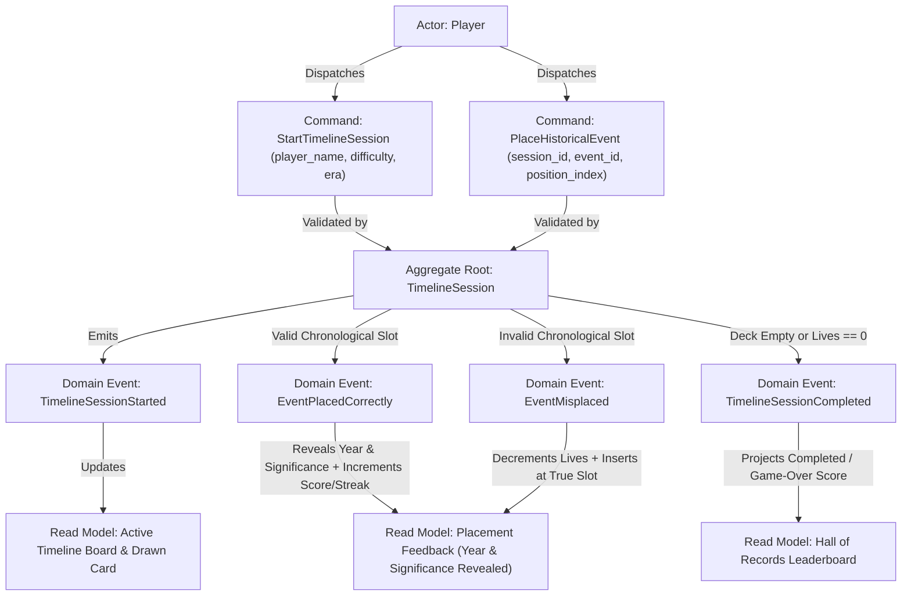

# Domain-Driven Design (DDD) & Event Storming Specification

This document defines the strategic and tactical Domain-Driven Design (DDD) model and Event Storming specification for **ChronoQuest** (`history-game`), an interactive World History Timeline Placement Challenge and Era Atlas.

---

## 1. Strategic DDD: Subdomains, Bounded Contexts & Context Map

### 1.1 Subdomain Classification

| Subdomain | Classification |Bounded Context | Responsibility |
| :--- | :--- | :--- | :--- |
| **Timeline Placement Gameplay** | **Core** | `TimelineGameplay` | Chronological card placement mechanics, anchor card initialization, slot validation (`position_index`), streak multipliers, life management, and Hall of Records leaderboard projections. |
| **World History Event Catalog** | **Supporting** | `HistoricalCatalog` | Curated catalog of 24 canonical historical events across 6 historical eras, era metadata, BCE/CE year modeling, and deterministic deck sampling. |

### 1.2 Context Map

`HistoricalCatalog` acts as an upstream **Open Host Service (OHS)** publishing an immutable **Published Language** of `HistoricalEvent` and `HistoricalEra` domain objects. `TimelineGameplay` consumes `HistoricalCatalog` downstream via repository ports, referencing catalog events strictly by typed `event_id` while projecting rich event details on session read models.

```mermaid
flowchart LR
    subgraph CatalogContext["Bounded Context: HistoricalCatalog (Supporting)"]
        EraVO["Value Object: HistoricalEra"]
        YearVO["Value Object: HistoricalYear"]
        EventAgg["Aggregate Root: HistoricalEvent"]
        CatalogRepo["Port: HistoricalEventRepositoryPort"]
    end

    subgraph GameplayContext["Bounded Context: TimelineGameplay (Core)"]
        DiffVO["Value Object: Difficulty"]
        AttemptEnt["Entity: PlacementAttempt"]
        SessionAgg["Aggregate Root: TimelineSession"]
        SessionRepo["Port: TimelineSessionRepositoryPort"]
        LeaderboardPort["CQRS Read Port: LeaderboardQueryPort"]
    end

    CatalogContext -->|"Open Host Service / Published Language (event_id)"| GameplayContext
```

---

## 2. Ubiquitous Language Glossary

Every identifier below is used verbatim across Event Storming, Gherkin `.feature` scenarios, Python `domain/` classes, SQLAlchemy persistence tables, OpenAPI 3.1 DTOs, and React UI components:

| Term | Kind | Definition & Invariants |
| :--- | :--- | :--- |
| `HistoricalEra` | Value Object (Enum) | Canonical period of world history: `ancient` (3500 BCE – 500 BCE), `classical` (500 BCE – 500 CE), `medieval` (500 CE – 1450 CE), `early_modern` (1450 CE – 1750 CE), `industrial` (1750 CE – 1914 CE), `modern` (1914 CE – Present). |
| `HistoricalYear` | Value Object | Immutable non-zero integer year (`year != 0`). Negative integers represent `BCE` (`-44` -> `"44 BCE"`); positive integers represent `CE` (`1969` -> `"1969 CE"`). Ordered chronologically via standard signed integer comparison. |
| `HistoricalEvent` | Aggregate Root (`HistoricalCatalog`) | A curated milestone in world history with stable `id`, `title`, `year` (`HistoricalYear`), `era` (`HistoricalEra`), `region`, clue `summary` (date-redacted description shown before placement), and `significance` (historical impact revealed upon placement). |
| `Difficulty` | Value Object (Enum) | Session challenge tier governing deck size, starting lives, and base points per correct placement: `explorer` (5 cards to place, 3 lives, 100 base pts), `historian` (8 cards to place, 3 lives, 150 base pts), `chronomaster` (12 cards to place, 2 lives, 200 base pts). |
| `TimelineSession` | Aggregate Root (`TimelineGameplay`) | Transactional consistency boundary for one player's timeline challenge run. Owns the ordered `timeline` of placed event IDs, the `current_event_id` awaiting placement, the `remaining_deck_ids`, `score`, `streak`, `max_streak`, `lives_remaining`, `status` (`in_progress`, `completed`, `game_over`), and child `PlacementAttempt` entities. |
| `Anchor Card` | Domain Concept | The initial `HistoricalEvent` placed face-up on the timeline (`index 0`) when a `TimelineSession` starts, giving the player an initial chronological reference point. |
| `Drawn Card` | Domain Concept | The unplaced `HistoricalEvent` (`current_event`) that the player must position relative to the cards already on the `timeline`. Its `year` and `significance` remain hidden until placement. |
| `position_index` | Value Object / Parameter | Zero-based chronological insertion slot (`0 <= position_index <= len(timeline)`) chosen by the player for the `Drawn Card`. |
| `PlacementAttempt` | Child Entity (`TimelineGameplay`) | Immutable record of a single placement turn within a `TimelineSession`, capturing `attempt_id`, `event_id`, `submitted_position`, `correct_position`, `is_correct`, `points_awarded`, `streak_after`, `lives_after`, and `recorded_at`. |
| `StartTimelineSession` | Command | Imperative command requesting a new `TimelineSession` for a given `player_name`, `difficulty`, optional `era` filter, and optional deterministic `seed`. |
| `PlaceHistoricalEvent` | Command | Imperative command submitting `event_id` at `position_index` for an active `TimelineSession`. |
| `TimelineSessionStarted` | Domain Event | Emitted when a `TimelineSession` is initialized with an `Anchor Card` on the timeline and the first `Drawn Card` ready to place. |
| `EventPlacedCorrectly` | Domain Event | Emitted when a player places the `Drawn Card` in a chronologically valid `position_index`, incrementing `streak`, awarding base + streak bonus points, and revealing the card's year and significance. |
| `EventMisplaced` | Domain Event | Emitted when a player places the `Drawn Card` in a chronologically invalid `position_index`, decrementing `lives_remaining`, resetting `streak` to `0`, and inserting the card into its true `correct_position` so the timeline stays sorted. |
| `TimelineSessionCompleted` | Domain Event | Emitted when a `TimelineSession` transitions from `in_progress` to `completed` (all deck cards placed with `lives_remaining > 0`) or `game_over` (`lives_remaining == 0`). |

---

## 3. Tactical DDD Building Blocks

### 3.1 Value Objects (`src/history_game/domain/value_objects.py`)

1. **`HistoricalYear`**:
   - **Attributes**: `value: int`
   - **Invariants**:
     - Rejects `value == 0` with `InvalidHistoricalYearError` (the historical Julian/Gregorian transition has no year 0; `1 BCE` is immediately followed by `1 CE`).
     - Rejects years outside `-10000 <= value <= 2100`.
   - **Behavior**:
     - `label` property: returns `f"{abs(self.value)} BCE"` when `value < 0` and `f"{self.value} CE"` when `value > 0`.
     - Total ordering (`__lt__`, `__le__`, `__gt__`, `__ge__`) based on `self.value`.

2. **`HistoricalEra` (`StrEnum`)**:
   - Enumerates the 6 canonical eras:
     - `ANCIENT = "ancient"` (`3500 BCE – 500 BCE`)
     - `CLASSICAL = "classical"` (`500 BCE – 500 CE`)
     - `MEDIEVAL = "medieval"` (`500 CE – 1450 CE`)
     - `EARLY_MODERN = "early_modern"` (`1450 CE – 1750 CE`)
     - `INDUSTRIAL = "industrial"` (`1750 CE – 1914 CE`)
     - `MODERN = "modern"` (`1914 CE – Present`)

3. **`Difficulty` (`StrEnum`)**:
   - Enumerates challenge tiers and encapsulates their gameplay rules:
     - `EXPLORER = "explorer"`: `cards_to_place = 5` (total deck `6` including 1 anchor), `initial_lives = 3`, `base_points = 100`, `streak_bonus = 25`.
     - `HISTORIAN = "historian"`: `cards_to_place = 8` (total deck `9` including 1 anchor), `initial_lives = 3`, `base_points = 150`, `streak_bonus = 50`.
     - `CHRONOMASTER = "chronomaster"`: `cards_to_place = 12` (total deck `13` including 1 anchor), `initial_lives = 2`, `base_points = 200`, `streak_bonus = 75`.
   - Note: If a single-era filter (`era != None`) has fewer available events in the catalog than `cards_to_place + 1`, the session deck size gracefully caps at `len(available_events)` (minimum 2 events: 1 anchor + at least 1 card to place).

4. **`SessionStatus` (`StrEnum`)**:
   - `IN_PROGRESS = "in_progress"`
   - `COMPLETED = "completed"`
   - `GAME_OVER = "game_over"`

### 3.2 Aggregate Roots & Entities (`src/history_game/domain/entities.py`)

#### Aggregate Root 1: `HistoricalEvent` (`HistoricalCatalog`)
- **Identity**: `id: str` (e.g., `"evt-rosetta-stone"`, `"evt-moon-landing"`)
- **Attributes**:
  - `title: str`
  - `year: HistoricalYear`
  - `era: HistoricalEra`
  - `region: str`
  - `summary: str` (date-free clue displayed while the card is drawn)
  - `significance: str` (educational narrative revealed after placement)
- **Invariants**:
  - `title`, `region`, `summary`, and `significance` must be non-empty trimmed strings.
  - `summary` must not leak the literal numeric year string.

#### Entity: `PlacementAttempt` (`TimelineGameplay`)
- **Identity**: `id: str` (UUID4 string)
- **Attributes**:
  - `session_id: str`
  - `event_id: str`
  - `submitted_position: int`
  - `correct_position: int`
  - `is_correct: bool`
  - `points_awarded: int`
  - `streak_after: int`
  - `lives_after: int`
  - `recorded_at: datetime`

#### Aggregate Root 2: `TimelineSession` (`TimelineGameplay`)
- **Identity**: `id: str` (UUID4 string)
- **Attributes**:
  - `player_name: str` (non-empty trimmed string, `1..64` chars)
  - `difficulty: Difficulty`
  - `era_filter: HistoricalEra | None`
  - `status: SessionStatus`
  - `score: int`
  - `streak: int`
  - `max_streak: int`
  - `lives_remaining: int`
  - `initial_lives: int`
  - `timeline_event_ids: list[str]` (chronologically ordered event IDs currently on the board)
  - `current_event_id: str | None` (the drawn card awaiting placement, or `None` when session has ended)
  - `remaining_deck_ids: list[str]` (queued unplaced event IDs)
  - `attempts: list[PlacementAttempt]`
  - `created_at: datetime`
  - `completed_at: datetime | None`
- **Core Domain Methods & Invariants**:
  1. **`TimelineSession.start(cmd: StartTimelineSession, deck: Sequence[HistoricalEvent]) -> TimelineSession`**:
     - Requires `len(deck) >= 2` (at least 1 anchor card and 1 card to place).
     - Places `deck[0]` on `timeline_event_ids`, sets `current_event_id = deck[1].id`, and queues `deck[2:]` in `remaining_deck_ids`.
     - Initializes `score = 0`, `streak = 0`, `max_streak = 0`, `lives_remaining = difficulty.initial_lives`, `status = SessionStatus.IN_PROGRESS`.
     - Emits `TimelineSessionStarted`.
  2. **`session.place_event(cmd: PlaceHistoricalEvent, events_by_id: Mapping[str, HistoricalEvent]) -> PlacementAttempt`**:
     - **Precondition 1 (Active Session)**: If `self.status != SessionStatus.IN_PROGRESS`, raises `SessionAlreadyCompletedError` (HTTP `409 Conflict` / `422 Unprocessable Entity`).
     - **Precondition 2 (Current Event Match)**: `cmd.event_id` must equal `self.current_event_id`; otherwise raises `UnexpectedEventPlacementError`.
     - **Precondition 3 (Bounds Check)**: `0 <= cmd.position_index <= len(self.timeline_event_ids)`; otherwise raises `InvalidPlacementPositionError`.
     - **Chronological Validation**:
       - Let `timeline_years = [events_by_id[eid].year.value for eid in self.timeline_event_ids]` and `target_year = events_by_id[cmd.event_id].year.value`.
       - `left_ok = (cmd.position_index == 0) or (timeline_years[cmd.position_index - 1] <= target_year)`
       - `right_ok = (cmd.position_index == len(timeline_years)) or (target_year <= timeline_years[cmd.position_index])`
       - `is_correct = left_ok and right_ok`
     - **True Insertion Slot (`correct_position`)**:
       - If `is_correct` is `True`, `correct_position = cmd.position_index`.
       - If `is_correct` is `False`, `correct_position` is the first index `i` where `target_year < timeline_years[i]` (or `len(timeline_years)` if greater than all placed years).
       - In both cases, `cmd.event_id` is inserted into `self.timeline_event_ids` at `correct_position` so the board remains strictly sorted in non-decreasing chronological order.
     - **Scoring & Lives Transition**:
       - If `is_correct`:
         - `self.streak += 1`
         - `self.max_streak = max(self.max_streak, self.streak)`
         - `points_awarded = self.difficulty.base_points + (self.streak - 1) * self.difficulty.streak_bonus`
         - `self.score += points_awarded`
         - Emits `EventPlacedCorrectly`.
       - If not `is_correct`:
         - `self.streak = 0`
         - `self.lives_remaining -= 1`
         - `points_awarded = 0`
         - Emits `EventMisplaced`.
     - **Deck Advancement & Completion Transition**:
       - If `self.lives_remaining <= 0`:
         - `self.status = SessionStatus.GAME_OVER`
         - `self.current_event_id = None`
         - `self.completed_at = utc_now`
         - Emits `TimelineSessionCompleted`.
       - Else if `len(self.remaining_deck_ids) == 0`:
         - `self.status = SessionStatus.COMPLETED`
         - `self.current_event_id = None`
         - `self.completed_at = utc_now`
         - Emits `TimelineSessionCompleted`.
       - Else:
         - Pops `self.remaining_deck_ids[0]` into `self.current_event_id`.

---

## 4. Event Storming Causal Flow

### 4.1 Event Storming Specification Table

| Step | Actor / Trigger | Imperative Command | Target Aggregate | Preconditions / Invariants | Emitted Domain Event(s) | Read Model / Downstream Projection |
| :--- | :--- | :--- | :--- | :--- | :--- | :--- |
| **1. Start Session** | Player selects difficulty & optional era | `StartTimelineSession` | `TimelineSession` | `player_name` non-empty; catalog has `>= 2` matching events | `TimelineSessionStarted` | Active Timeline Board initialized with 1 face-up Anchor Card and 1 unplaced Drawn Card |
| **2a. Correct Placement** | Player clicks insertion slot `position_index` | `PlaceHistoricalEvent` | `TimelineSession` | Session is `in_progress`; `event_id == current_event_id`; `left.year <= event.year <= right.year` | `EventPlacedCorrectly` (+ `TimelineSessionCompleted` if last card) | Card inserted at `position_index`; year & significance revealed; score & streak increased; next card drawn |
| **2b. Misplaced Event** | Player clicks insertion slot `position_index` | `PlaceHistoricalEvent` | `TimelineSession` | Session is `in_progress`; `event_id == current_event_id`; chronological invariant violated | `EventMisplaced` (+ `TimelineSessionCompleted` if `lives_remaining == 0` or last card) | Card moved to `correct_position`; year & significance revealed; `lives_remaining` decremented; `streak` reset to `0` |
| **3. Session Completion** | Last card placed or `lives_remaining == 0` | *(Triggered within `PlaceHistoricalEvent`)* | `TimelineSession` | `remaining_deck` empty or `lives_remaining == 0` | `TimelineSessionCompleted` | Session summary banner & Hall of Records (`GET /api/v1/leaderboard`) updated |
