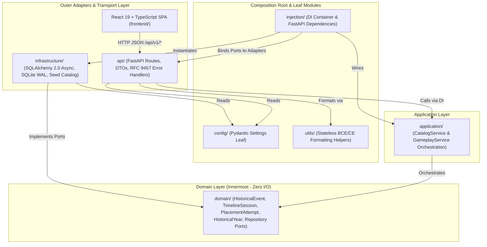
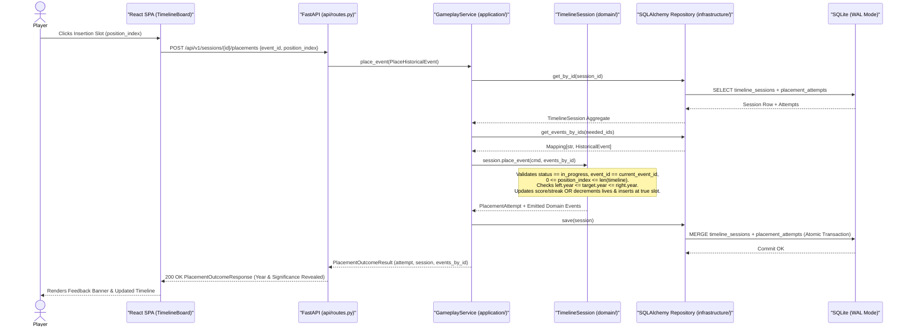
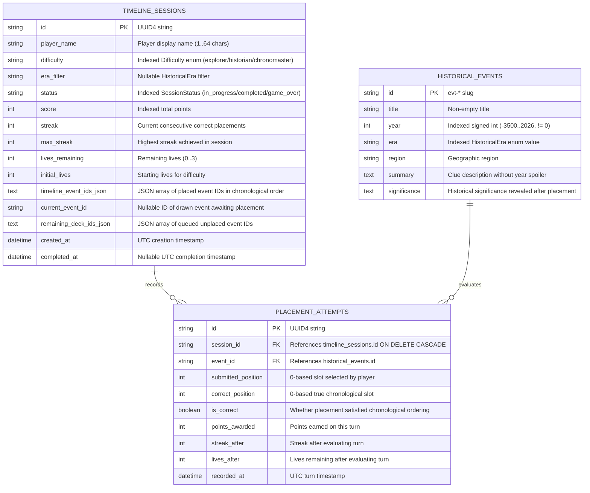

# Software Design Document (SDD): ChronoQuest (`history-game`)

## 1. High-Level Architecture Overview

**ChronoQuest** (`history-game`) is a full-stack web application built with **Python 3.12+**, **FastAPI**, **SQLAlchemy 2.0 (async)** + **Alembic** + **SQLite (WAL mode)** on the backend, and **React 19** + **TypeScript** + **Vite** on the frontend. The backend strictly enforces **Clean / Hexagonal Architecture** with inward-pointing dependencies across `domain`, `application`, `infrastructure`, `api`, `config`, `utils`, and `injection`.



---

## 2. Clean / Hexagonal Layer Boundaries

All backend code lives under `src/history_game/` and obeys strict inward import rules enforced by `check_architecture_gates.sh`:

| Layer (`src/history_game/<layer>`) | Key Modules | Allowed Imports | Forbidden Imports |
| :--- | :--- | :--- | :--- |
| **`domain/`** | `value_objects.py`, `entities.py`, `events.py`, `exceptions.py`, `repositories.py` | Python standard library (`dataclasses`, `datetime`, `enum`, `abc`, `uuid`, `typing`, `re`), dependency-free `utils` | `application`, `infrastructure`, `api`, `injection`, `fastapi`, `sqlalchemy`, `pydantic` |
| **`application/`** | `services.py` (`CatalogService`, `GameplayService`, `SessionStateResult`, `PlacementOutcomeResult`) | `domain`, `config`, `utils`, Python stdlib | `infrastructure`, `api`, `injection`, `fastapi`, `sqlalchemy` |
| **`infrastructure/`** | `persistence/database.py`, `persistence/models.py`, `persistence/repositories.py`, `persistence/seed_data.py` | `domain`, `config`, `utils`, `sqlalchemy`, `aiosqlite`, `alembic` | `application`, `api`, `injection`, `fastapi` |
| **`api/`** | `app.py`, `routes.py`, `dto.py`, `errors.py` | `application`, `domain`, `config`, `utils`, `injection`, `fastapi`, `pydantic` | Direct `infrastructure.persistence` queries inside route handlers (routes only call `CatalogService` and `GameplayService`; `app.py` manages process `lifespan` startup/shutdown) |
| **`injection/`** | `container.py` | All layers (composition root binding `HistoricalEventRepositoryPort` and `TimelineSessionRepositoryPort` to SQLite/SQLAlchemy adapters) | — |
| **`config/`** | `settings.py` | `pydantic_settings`, `utils`, Python stdlib | `domain`, `application`, `infrastructure`, `api`, `injection` |
| **`utils/`** | `formatting.py` | Python stdlib only | All service layers |

---

## 3. Phase-by-Phase Technical Breakdown & Sequence Flows

### 3.1 Session Creation Flow (`POST /api/v1/sessions`)

1. **Parsing & DTO Validation (`api/routes.py` -> `api/dto.py`)**:
   - FastAPI validates `CreateSessionRequest` (`player_name` length `1..64`, `difficulty` in `Difficulty`, optional `era` in `HistoricalEra`, optional integer `seed`).
2. **Deck Sampling (`application/services.py`)**:
   - `GameplayService.start_session(cmd: StartTimelineSession)` queries `HistoricalEventRepositoryPort.list_events(era=cmd.era)`.
   - Requires at least 2 catalog events; determines target deck size `min(len(available_events), cmd.difficulty.cards_to_place + 1)`.
   - Samples `deck = rng.sample(available_events, k=target_deck_size)` deterministically using `random.Random(cmd.seed)`.
3. **Aggregate Initialization (`domain/entities.py`)**:
   - `TimelineSession.start(cmd, deck)` sets `timeline_event_ids = [deck[0].id]` (the face-up **Anchor Card**), `current_event_id = deck[1].id` (the first **Drawn Card**), and `remaining_deck_ids = [e.id for e in deck[2:]]`.
   - Emits `TimelineSessionStarted`.
4. **Atomic Persistence (`infrastructure/persistence/repositories.py`)**:
   - `SqlAlchemyTimelineSessionRepository.save(session)` persists the `TimelineSessionModel` row inside an async transaction (`session.merge` + `session.commit`) and returns `SessionStateResult`.

### 3.2 Event Placement & Evaluation Sequence (`POST /api/v1/sessions/{session_id}/placements`)



---

## 4. REST API Contract & Payload Schemas (OpenAPI 3.1)

### 4.1 Endpoint Summary

| Method & Path | Tag | Status Codes | Description |
| :--- | :--- | :--- | :--- |
| `GET /healthz` | `health` | `200 OK` | Process liveness probe (`{"status": "ok", "service": "history-game", "version": "0.1.0"}`). |
| `GET /readyz` | `health` | `200 OK`, `503` | Readiness probe verifying async SQLite connectivity (`SELECT 1`). |
| `GET /api/v1/eras` | `catalog` | `200 OK` | Lists all 6 canonical `HistoricalEra` metadata entries with chronological bounds and event counts. |
| `GET /api/v1/events` | `catalog` | `200 OK`, `422` | Lists curated `HistoricalEvent` records ordered by `year ASC`, with optional `?era=<HistoricalEra>` filter. |
| `POST /api/v1/sessions` | `sessions` | `201 Created`, `422` | Starts a new `TimelineSession` with 1 Anchor Card on the timeline and 1 Drawn Card to place. |
| `GET /api/v1/sessions/{session_id}` | `sessions` | `200 OK`, `404` | Retrieves the current state of a `TimelineSession`, its sorted `timeline` cards, `current_event`, and `attempts`. |
| `POST /api/v1/sessions/{session_id}/placements` | `sessions` | `200 OK`, `404`, `409`, `422` | Submits a `PlaceHistoricalEvent` command (`event_id`, `position_index`) and returns the `PlacementAttempt` outcome and updated `TimelineSession`. |
| `GET /api/v1/leaderboard` | `leaderboard` | `200 OK`, `422` | Returns top completed/finished sessions ordered by `score DESC, max_streak DESC, completed_at ASC`, with optional `?difficulty=<Difficulty>&limit=<int>`. |

### 4.2 Request & Response JSON Examples

#### `GET /api/v1/eras` (`200 OK`)
```json
[
  {
    "era": "ancient",
    "label": "Ancient World",
    "start_year": -3500,
    "end_year": -500,
    "period_label": "3500 BCE – 500 BCE",
    "description": "Early river-valley civilizations, writing systems, monumental architecture, and bronze-to-iron age empires.",
    "event_count": 4
  }
]
```

#### `GET /api/v1/events?era=ancient` (`200 OK`)
```json
[
  {
    "id": "evt-cuneiform-writing",
    "title": "Development of Sumerian Cuneiform Writing",
    "year": -3200,
    "year_label": "3200 BCE",
    "era": "ancient",
    "era_label": "Ancient World",
    "region": "Mesopotamia",
    "summary": "Sumerian scribes in Uruk press wedge-shaped reed styluses into clay tablets to record trade and temple accounts.",
    "significance": "Inaugurated recorded human history by enabling durable legal, economic, and literary archives."
  }
]
```

#### `POST /api/v1/sessions` (`201 Created`)
Request:
```json
{
  "player_name": "Ada Lovelace",
  "difficulty": "explorer",
  "era": null,
  "seed": 42
}
```
Response:
```json
{
  "id": "8f14e45f-ceea-467a-9a38-1b2c3d4e5f6a",
  "player_name": "Ada Lovelace",
  "difficulty": "explorer",
  "era_filter": null,
  "status": "in_progress",
  "score": 0,
  "streak": 0,
  "max_streak": 0,
  "lives_remaining": 3,
  "initial_lives": 3,
  "cards_remaining": 5,
  "timeline": [
    {
      "id": "evt-printing-press",
      "title": "Gutenberg Introduces the Movable-Type Printing Press",
      "year": 1450,
      "year_label": "1450 CE",
      "era": "early_modern",
      "era_label": "Early Modern Era",
      "region": "Europe",
      "summary": "Johannes Gutenberg combines oil-based inks, durable metal type molds, and a wooden screw press in Mainz.",
      "significance": "Accelerated the Renaissance and Scientific Revolution by democratizing access to printed knowledge."
    }
  ],
  "current_event": {
    "id": "evt-rosetta-stone",
    "title": "Inscribing of the Rosetta Stone Decree",
    "era": "classical",
    "era_label": "Classical Era",
    "region": "Egypt",
    "summary": "A royal decree issued at Memphis is carved into black granodiorite in three scripts: hieroglyphs, Demotic, and Ancient Greek."
  },
  "attempts": [],
  "created_at": "2026-11-15T12:00:00Z",
  "completed_at": null
}
```

#### `POST /api/v1/sessions/{session_id}/placements` (`200 OK`)
Request:
```json
{
  "event_id": "evt-rosetta-stone",
  "position_index": 0
}
```
Response:
```json
{
  "attempt": {
    "id": "c91a7b2e-1122-4a33-8899-001122334455",
    "event_id": "evt-rosetta-stone",
    "placed_event": {
      "id": "evt-rosetta-stone",
      "title": "Inscribing of the Rosetta Stone Decree",
      "year": -196,
      "year_label": "196 BCE",
      "era": "classical",
      "era_label": "Classical Era",
      "region": "Egypt",
      "summary": "A royal decree issued at Memphis is carved into black granodiorite in three scripts: hieroglyphs, Demotic, and Ancient Greek.",
      "significance": "Provided the breakthrough key that allowed 19th-century scholars to decipher ancient Egyptian hieroglyphs."
    },
    "submitted_position": 0,
    "correct_position": 0,
    "is_correct": true,
    "points_awarded": 100,
    "streak_after": 1,
    "lives_after": 3,
    "recorded_at": "2026-11-15T12:00:08Z"
  },
  "session": {
    "id": "8f14e45f-ceea-467a-9a38-1b2c3d4e5f6a",
    "player_name": "Ada Lovelace",
    "difficulty": "explorer",
    "era_filter": null,
    "status": "in_progress",
    "score": 100,
    "streak": 1,
    "max_streak": 1,
    "lives_remaining": 3,
    "initial_lives": 3,
    "cards_remaining": 4,
    "timeline": [
      {
        "id": "evt-rosetta-stone",
        "title": "Inscribing of the Rosetta Stone Decree",
        "year": -196,
        "year_label": "196 BCE",
        "era": "classical",
        "era_label": "Classical Era",
        "region": "Egypt",
        "summary": "A royal decree issued at Memphis is carved into black granodiorite in three scripts: hieroglyphs, Demotic, and Ancient Greek.",
        "significance": "Provided the breakthrough key that allowed 19th-century scholars to decipher ancient Egyptian hieroglyphs."
      },
      {
        "id": "evt-printing-press",
        "title": "Gutenberg Introduces the Movable-Type Printing Press",
        "year": 1450,
        "year_label": "1450 CE",
        "era": "early_modern",
        "era_label": "Early Modern Era",
        "region": "Europe",
        "summary": "Johannes Gutenberg combines oil-based inks, durable metal type molds, and a wooden screw press in Mainz.",
        "significance": "Accelerated the Renaissance and Scientific Revolution by democratizing access to printed knowledge."
      }
    ],
    "current_event": {
      "id": "evt-apollo-11",
      "title": "Apollo 11 First Crewed Lunar Landing",
      "era": "modern",
      "era_label": "Modern Era",
      "region": "Space / Global",
      "summary": "Astronauts aboard the lunar module Eagle touch down on the Sea of Tranquility during the Space Race."
    },
    "attempts": [
      {
        "id": "c91a7b2e-1122-4a33-8899-001122334455",
        "event_id": "evt-rosetta-stone",
        "placed_event": {
          "id": "evt-rosetta-stone",
          "title": "Inscribing of the Rosetta Stone Decree",
          "year": -196,
          "year_label": "196 BCE",
          "era": "classical",
          "era_label": "Classical Era",
          "region": "Egypt",
          "summary": "A royal decree issued at Memphis is carved into black granodiorite in three scripts: hieroglyphs, Demotic, and Ancient Greek.",
          "significance": "Provided the breakthrough key that allowed 19th-century scholars to decipher ancient Egyptian hieroglyphs."
        },
        "submitted_position": 0,
        "correct_position": 0,
        "is_correct": true,
        "points_awarded": 100,
        "streak_after": 1,
        "lives_after": 3,
        "recorded_at": "2026-11-15T12:00:08Z"
      }
    ],
    "created_at": "2026-11-15T12:00:00Z",
    "completed_at": null
  }
}
```

### 4.3 RFC 9457 Problem Details Error Envelope (`api/errors.py`)

All domain and validation errors return `Content-Type: application/problem+json` conforming to RFC 9457:

```json
{
  "type": "https://chronoquest.local/problems/session_not_found",
  "title": "Resource Not Found",
  "status": 404,
  "detail": "Timeline session 'non-existent-id' was not found.",
  "instance": "/api/v1/sessions/non-existent-id"
}
```

| Domain Exception / Error Source | Error Code (`exc.code`) | HTTP Status | Title |
| :--- | :--- | :---: | :--- |
| `EntityNotFoundError` | `entity_not_found` | `404 Not Found` | `Resource Not Found` |
| `SessionAlreadyCompletedError` | `session_already_completed` | `409 Conflict` | `Session Already Completed` |
| `InvalidPlacementPositionError` | `invalid_placement_position` | `422 Unprocessable Entity` | `Invalid Game Action` |
| `UnexpectedEventPlacementError` | `unexpected_event_placement` | `422 Unprocessable Entity` | `Invalid Game Action` |
| `InvalidGameActionError` | `invalid_game_action` | `422 Unprocessable Entity` | `Invalid Game Action` |
| `RequestValidationError` (Pydantic) | `validation_error` | `422 Unprocessable Entity` | `Request Validation Error` |
| `DomainError` (base fallback) | `domain_error` | `400 Bad Request` | `Domain Error` |

---

## 5. Persistence Schema (SQLite WAL + SQLAlchemy 2.0 + Alembic)

### 5.1 Entity-Relationship Diagram



### 5.2 SQLite WAL & Concurrency Configuration
- Every SQLite connection created by `infrastructure/persistence/database.py` executes:
  - `PRAGMA journal_mode=WAL;`
  - `PRAGMA synchronous=NORMAL;`
  - `PRAGMA foreign_keys=ON;`
  - `PRAGMA busy_timeout=5000;`
- All constraint names use deterministic SQLAlchemy `MetaData(naming_convention=...)` prefixes (`pk_`, `uq_`, `ix_`, `ck_`, `fk_`) for zero-downtime Alembic batch migration portability.
